<picture>
  <source media="(prefers-color-scheme: dark)" srcset="/.github/banner_dark.png">
  <source media="(prefers-color-scheme: light)" srcset="/.github/banner_light.png">
  
</picture>

<h1 align="center">LiveKit Portal</h1>

<p align="center">
  <a href="https://github.com/livekit/portal/actions/workflows/tests.yml"></a>
  <a href="https://pypi.org/project/livekit-portal/"></a>
  <a href="LICENSE"></a>
  <a href="https://www.python.org/downloads/"></a>
</p>

<!--BEGIN_DESCRIPTION-->
<p align="center"><b>Teleoperate robots, run remote policies, and record demonstrations with LiveKit Portal.</b></p>
<!--END_DESCRIPTION-->

<p align="center">
  <a href="docs/01-quickstart.md">Quickstart</a> ·
  <a href="docs/">Documentation</a> ·
  <a href="#examples">Examples</a>
</p>

LiveKit Portal connects robots to remote operators over the internet. It carries
camera frames and robot state to the operator, and control actions back to the
robot. It works with any robotics stack, using LiveKit Cloud or a self-hosted
LiveKit server.

## What Portal adds

- **Low-latency video.** LiveKit advertises [glass-to-glass latency as low as
  30 ms](https://livekit.com/robotics). Actual latency depends on the network,
  hardware, codec, and buffering. Use Portal's [metrics](docs/09-metrics.md)
  to measure the full observation-to-action loop, including policy inference.
- **Control arbitration.** Keep policies and human operators in the same session.
  The robot accepts actions from one active operator; transfer control with one
  call or let a supervisor coordinate handoffs. [Control handoff](docs/04-arbitration.md).
- **Synchronized observations.** Receive camera frames and joint state together,
  matched by capture timestamp, so a remote policy can compute its next action.
  [Observations](docs/02-concepts.md#the-observation-model).
- **Shared robot time.** Participants synchronize to the robot's clock, giving
  actions, recordings, and annotations a common timeline across machines.
  [Time sync](docs/05-portal-api.md#time-sync).
- **Data recording sinks.** Add an observer to record alongside any operator.
  Write Rerun archives with `RrdSink`, or implement a sink for your own storage
  format. [Data recording](docs/03-data-recording.md).
- **Policy evaluation.** Record inactive policies' actions for comparison, mark
  episodes with annotations, and measure observation-to-action latency.
  [Action subscriptions](docs/05-portal-api.md#operator-side-action-subscription)
  and [metrics](docs/09-metrics.md).
- **Video for models and people.** Use WebRTC video for live viewing, PNG or RAW
  for exact RGB pixels, or MJPEG for independent frame compression.
  [Frame video](docs/07-frame-video.md).

## Why LiveKit Portal

Imagine your robot has two operators: a policy running in the cloud and a human
ready to take over. The policy misses a grasp. The human steps in, demonstrates
a correction, then returns control. You want to record the entire session to
improve the policy.

Building this directly on vanilla WebRTC,
[WebSockets](https://www.rfc-editor.org/rfc/rfc6455.html), or
[Media over QUIC (MoQ)](https://datatracker.ietf.org/doc/draft-ietf-moq-transport/)
gives you transport primitives; the robot's control arbitration remains your
application's job. You need to track participants, choose the active operator,
propagate handoffs, and reject commands from inactive operators. That means
maintaining shared session state in a coordination service or realtime database,
and handling concurrent requests and reconnects.

<picture>
  <source media="(prefers-color-scheme: dark)" srcset="docs/images/why-arbitration-dark.svg">
  
</picture>

You also need clock synchronization and a buffering strategy for streams arriving
at different times. As participants join from different networks, you must keep
observations aligned without letting a slow stream add excessive control latency.

<picture>
  <source media="(prefers-color-scheme: dark)" srcset="docs/images/why-timing-dark.svg">
  
</picture>

A recorder that logs only the teleoperator's inputs misses the policy's actions.
If it timestamps incoming data on arrival, network delays become part of the
recording: a camera frame and a joint reading captured together appear to have
happened at different times. Separate logs from each machine leave you to
reconstruct the handoff across different clocks.

<picture>
  <source media="(prefers-color-scheme: dark)" srcset="docs/images/why-recording-dark.svg">
  
</picture>

Portal puts the robot, both operators, and an independent recorder in one
LiveKit room. The robot accepts actions from the active operator, and a single
call transfers control. LiveKit distributes the active-operator state through
participant attributes, so you do not need a separate database for that handoff.
Participants synchronize to the robot's clock, so
frames, state, actions, and episode annotations share a timeline. The recorder
can capture both operators' actions, including what the policy proposed while
the human was in control, with each action labeled by sender and control status.

<picture>
  <source media="(prefers-color-scheme: dark)" srcset="docs/images/portal-room-dark.svg">
  
</picture>

That gives you the policy attempt, the human correction, and the context needed
to compare them in one recording. Write it to a Rerun archive or your own sink,
then choose how to align and select samples for training.

LiveKit provides the foundation: multi-participant rooms and WebRTC transport
across NAT and changing network conditions, without a VPN or manual port
forwarding. Portal adds observation matching, clock synchronization, control
arbitration, and recording. The same code runs on LiveKit Cloud or a self-hosted
server.

Start with one robot and one operator, then add a human or recorder as your
application grows.

## Get started

```bash
uv add livekit-portal
# or
pip install livekit-portal
```

Follow the [quickstart](docs/01-quickstart.md) to run your first control loop
without physical hardware. Then add [control handoff](docs/04-arbitration.md)
and [data recording](docs/03-data-recording.md).
For an existing LeRobot application, use the [LeRobot plugins](docs/reference/lerobot.md).

## Examples

| Example | What it demonstrates |
|---|---|
| [Basic](examples/python/basic) | Synthetic video, actions, recording, and control handoff. No hardware required. |
| [Inference](examples/python/inference) | A policy that plans actions and sends one per control tick. |
| [Cloud inference](examples/python/modal-mock-inference) | A policy running on Modal, with latency measurements. |
| [SO-101](examples/python/so101) | A remote leader arm controlling a physical follower. |

For configuration, tuning, and troubleshooting, see the [documentation](docs/).
For methods and callbacks, see the [API reference](docs/05-portal-api.md).

## License

Apache-2.0. See [LICENSE](LICENSE) for details.

<br/><table>

<thead><tr><th colspan="2">LiveKit Ecosystem</th></tr></thead>
<tbody>
<tr><td>Agents SDKs</td><td><a href="https://github.com/livekit/agents">Python</a> · <a href="https://github.com/livekit/agents-js">Node.js</a></td></tr><tr></tr>
<tr><td>LiveKit SDKs</td><td><a href="https://github.com/livekit/client-sdk-js">Browser</a> · <a href="https://github.com/livekit/client-sdk-swift">Swift</a> · <a href="https://github.com/livekit/client-sdk-android">Android</a> · <a href="https://github.com/livekit/client-sdk-flutter">Flutter</a> · <a href="https://github.com/livekit/client-sdk-react-native">React Native</a> · <a href="https://github.com/livekit/rust-sdks">Rust</a> · <a href="https://github.com/livekit/node-sdks">Node.js</a> · <a href="https://github.com/livekit/python-sdks">Python</a> · <a href="https://github.com/livekit/client-sdk-unity">Unity</a> · <a href="https://github.com/livekit/client-sdk-unity-web">Unity (WebGL)</a> · <a href="https://github.com/livekit/client-sdk-esp32">ESP32</a> · <a href="https://github.com/livekit/client-sdk-cpp">C++</a></td></tr><tr></tr>
<tr><td>Starter Apps</td><td><a href="https://github.com/livekit-examples/agent-starter-python">Python Agent</a> · <a href="https://github.com/livekit-examples/agent-starter-node">TypeScript Agent</a> · <a href="https://github.com/livekit-examples/agent-starter-react">React App</a> · <a href="https://github.com/livekit-examples/agent-starter-swift">SwiftUI App</a> · <a href="https://github.com/livekit-examples/agent-starter-android">Android App</a> · <a href="https://github.com/livekit-examples/agent-starter-flutter">Flutter App</a> · <a href="https://github.com/livekit-examples/agent-starter-react-native">React Native App</a> · <a href="https://github.com/livekit-examples/agent-starter-embed">Web Embed</a></td></tr><tr></tr>
<tr><td>UI Components</td><td><a href="https://github.com/livekit/components-js">React</a> · <a href="https://github.com/livekit/components-android">Android Compose</a> · <a href="https://github.com/livekit/components-swift">SwiftUI</a> · <a href="https://github.com/livekit/components-flutter">Flutter</a></td></tr><tr></tr>
<tr><td>Server APIs</td><td><a href="https://github.com/livekit/node-sdks">Node.js</a> · <a href="https://github.com/livekit/server-sdk-go">Golang</a> · <a href="https://github.com/livekit/server-sdk-ruby">Ruby</a> · <a href="https://github.com/livekit/server-sdk-kotlin">Java/Kotlin</a> · <a href="https://github.com/livekit/python-sdks">Python</a> · <a href="https://github.com/livekit/rust-sdks">Rust</a> · <a href="https://github.com/agence104/livekit-server-sdk-php">PHP (community)</a> · <a href="https://github.com/pabloFuente/livekit-server-sdk-dotnet">.NET (community)</a></td></tr><tr></tr>
<tr><td>Resources</td><td><a href="https://docs.livekit.io">Docs</a> · <a href="https://docs.livekit.io/mcp">Docs MCP Server</a> · <a href="https://github.com/livekit/livekit-cli">CLI</a> · <a href="https://cloud.livekit.io">LiveKit Cloud</a></td></tr><tr></tr>
<tr><td>LiveKit Server OSS</td><td><a href="https://github.com/livekit/livekit">LiveKit server</a> · <a href="https://github.com/livekit/egress">Egress</a> · <a href="https://github.com/livekit/ingress">Ingress</a> · <a href="https://github.com/livekit/sip">SIP</a></td></tr><tr></tr>
<tr><td>Community</td><td><a href="https://community.livekit.io">Developer Community</a> · <a href="https://livekit.io/join-slack">Slack</a> · <a href="https://x.com/livekit">X</a> · <a href="https://www.youtube.com/@livekit_io">YouTube</a></td></tr>
</tbody>
</table>
