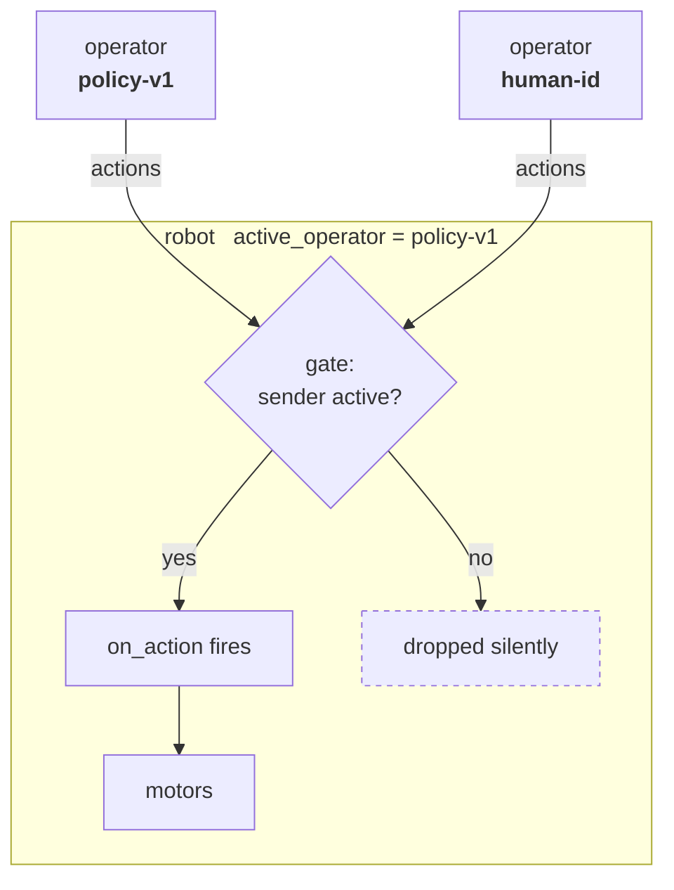

# Concepts

Consider a robot arm controlled by a policy on another machine. The policy
needs camera frames and joint positions to choose an action. A human may need
to take over, and a recorder may need to save both demonstrations and policy runs.

Portal connects these processes in a LiveKit room. This page follows the data
from the robot to the policy, explains how control transfers, and describes the
frame format and callback behavior you need when connecting your own hardware.

## Roles

Choose a class based on what the process needs to do:

| Class | Use it to | Sends | Receives |
|---|---|---|---|
| `Robot` | Connect cameras and hardware | Frames and state | Actions from the active operator |
| `Operator` | Run a policy or human teleoperator | Actions | Frames and state, matched into observations by default |
| `Observer` | Record a session or supervise control | Annotations and control requests | Raw frames, state, and active actions by default |

Each session has one robot and any number of operators and observers. For
example, a policy and a human each use `Operator`, while a separate recorder
uses `Observer`. An observer can transfer control but cannot send motor actions.

Participants declare camera names and state and action fields before connecting.
These declarations are the **schema**: they specify how to interpret data such
as a floating-point joint position or a boolean gripper command. Field names,
order, and data types must match between senders and receivers. Use a
[shared YAML file](reference/config-file.md) to keep them consistent.

Roles are fixed at construction. Each class only has its own role's methods:
`Operator` has no `send_state`, for example. An `Observer`'s `send_*` methods
exist only to raise `PortalError.WrongRole`.

## The observation model

A policy needs camera frames and joint readings from the same moment. Pairing
an old image with the latest joint position can describe a pose the robot never
held.

Video and state travel independently. Encoding and decoding can delay video
relative to state, even when the robot captures both together. Portal uses
capture timestamps to match them instead of pairing them by arrival time.
The operator receives an `Observation` containing the matched data:

```python
Observation(
    frames={"cam1": VideoFrameData, "wrist": VideoFrameData},
    state={"j1": 0.1, "j2": -0.3, "gripper": True},
    timestamp_us=1717171717000000,
)
```

An observation fires only when **every** declared video track has a frame close
enough to that state. States that never find a match are reported separately
through `on_drop`.

`obs.state` holds Python-native types per your declared dtypes. A `BOOL` field
is a real `bool`, an `I8` field is an `int`. `obs.raw_state` gives you the same
data as all-`float` if you would rather write straight into a NumPy buffer.

Each `VideoFrameData` carries packed RGB24 bytes in `.data`, plus `.width`,
`.height`, and `.timestamp_us`. Convert it with the shipped helper:

```python
from livekit.portal import frame_bytes_to_numpy_rgb

rgb = frame_bytes_to_numpy_rgb(bytes(frame.data), frame.width, frame.height)
# rgb is uint8, shape (H, W, 3), RGB order.
```

> **Note.** The helper returns a zero-copy view over the frame bytes. Call
> `.copy()` before mutating it.

### How matching works

For each state sample, Portal looks for the nearest frame from every declared
camera within a configured time window. With the defaults, that window is
50 ms on either side of the state's timestamp.

- If every camera has a match, Portal delivers an observation.
- If a frame could still arrive within the window, Portal waits.
- If a camera has advanced beyond the window, Portal reports the unmatched
  state through `on_drop`.

For example, a wrist camera can delay an observation even while the front
camera is streaming. Use [tuning](06-tuning.md) to adjust the window or choose
what happens when a camera stalls. The [synchronization reference](reference/synchronization.md)
describes the matching algorithm.

### Handling drops

`on_drop` receives a **list** of state dicts, not a single state. Each dict has
the same shape as `obs.state`. There is no timestamp on them.

```python
def on_drop(dropped):
    # dropped is List[Dict[str, bool | int | float]]
    print(f"lost {len(dropped)} states")

op.on_drop(on_drop)
```

A few drops at startup are normal while video warms up. A steady stream of them
means the match window is too tight or a camera is behind. See
[Troubleshooting](10-troubleshooting.md#sync-drop).

## Control handoff

The robot listens to exactly one operator at a time. Which one is named by a
single piece of state the robot publishes, the **active operator**.



Participants can read the active identity. Operators and observers can request
a change; the robot's value determines whose actions reach its callback.

Handoff is one call, from any participant:

```python
# A human preempts the policy.
await human.set_active_operator(human.local_identity())

# ... teleoperate for a while ...

# Hand control back.
await human.set_active_operator("policy-v1")
```

Participants remain connected during the handoff. The robot accepts subsequent
actions according to the updated active identity.

Three behaviors are worth knowing up front.

**Control starts unset.** A fresh robot has no active operator, unless its token
seeds one, and drops every action it receives. Your first operator has to claim control, or nothing
moves. This is the most common first-run surprise.

**Inactive operators get no feedback.** Their `send_action` calls succeed and
the packets reach the robot, which drops them. There is no error and no
callback. Read `op.active_operator()` if you need to know whether you are being
accepted.

**Control persists across disconnects.** If the active operator drops off,
the robot keeps pointing at that identity so a reconnect resumes control. To
move it, someone has to call `set_active_operator` with a new identity.

For human in the loop and orchestration end to end, see
[Arbitration](04-arbitration.md). Full mechanics and the callback list are in
[Portal API](05-portal-api.md#the-active-operator).

## Putting it together

A control loop follows these steps:

1. The robot reads its cameras and joints, then publishes frames and state with
   capture timestamps.
2. The operator matches frames to state and calls `on_observation`.
3. Your policy computes an action and sends it with `send_action`.
4. The robot checks the sender against the active operator and calls `on_action`
   for accepted actions. Your callback applies them to the hardware.

An observer can record the streams alongside this loop. By default it keeps
frames and state separately, preserving timestamps for alignment after recording.
See [Data recording](03-data-recording.md).

## Video frame format

`send_video_frame` expects packed **RGB24**. Byte order is `R, G, B`, one byte
per channel, no alpha. The layout is row-major and tightly packed, so
`stride = width * 3` and an exact buffer is `width * height * 3` bytes.

That is exactly a NumPy `uint8` array of shape `(H, W, 3)` in RGB order, which
is what `PIL.Image.convert("RGB")` and OpenCV's
`cvtColor(frame, COLOR_BGR2RGB)` give you.

**On WebRTC tracks, width and height must both be even.** I420 chroma
subsampling requires it. Odd dimensions raise
`PortalError.InvalidFrameDimensions`. [Frame-video](07-frame-video.md) tracks
have no such constraint.

The default WebRTC path converts RGB to I420 before encoding. If your policy
or dataset requires exact RGB pixels, select PNG or RAW instead. See
[Frame video](07-frame-video.md) for codec choices and their bandwidth costs.

### Frames must carry a timestamp

Every WebRTC video frame Portal receives must carry `user_timestamp` in its
LiveKit frame metadata. Portal sets this automatically on tracks it publishes.
Frames without it are dropped and logged as
[`missing-timestamp`](10-troubleshooting.md#missing-timestamp).

A subscribed track from a publisher that does **not** set it cannot be matched
and is unsupported. Either republish the source through Portal, or enable
user-timestamp trailers on the upstream publisher. The
[wire protocol](reference/wire-protocol.md#webrtc-video-tracks) page has the
detail if you are writing your own publisher.

## Callbacks and threading

Callbacks you register with `on_observation`, `on_action`, and friends fire on
the asyncio loop that called `connect()`. Your code never
runs on the tokio worker thread.

That means a slow callback stalls your own loop, not Portal's internals. It
does still cost you frames, because the per-track receive path sheds frames
when processing falls behind. Keep callbacks short and move heavy work
elsewhere. See [`recv-overflow`](10-troubleshooting.md#recv-overflow).

If a Python callback raises, Portal prints its traceback and keeps the session
running. Monitor application logs to detect callback failures.

## Next steps

- [Portal API](05-portal-api.md). Configuration, methods, and callbacks.
- [Tuning](06-tuning.md). Adjust the matching window and handle camera stalls.
- [Metrics](09-metrics.md). What to watch in production.
- [Synchronization](reference/synchronization.md). The full matching algorithm.
