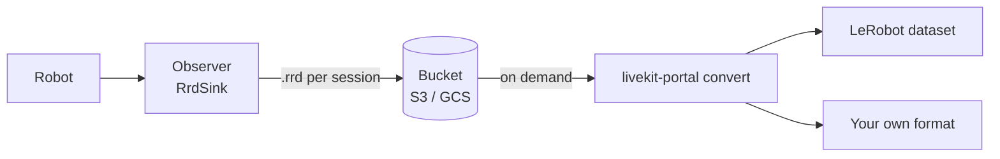

# Data recording

Record a session when you need to review a robot run, collect demonstrations,
or compare a policy with human corrections. A recording keeps camera frames,
state, actions, and annotations on a shared timeline.

Use an `Observer` to receive these streams without driving the robot. Attach a
**sink**, the object that writes incoming data to storage. The built-in `RrdSink`
writes [Rerun](https://rerun.io) `.rrd` archives; a custom sink can write another
format. This guide covers recording, reviewing the archive, and preparing data
for training.

Start with the runnable [quickstart recorder](01-quickstart.md#7-add-an-observer-to-record-data).
The fragments below assume the same credentials and schema.

## The observer

An observer is built like an operator. Declare the same schema and tracks as
the robot, construct it, connect.

```python
from livekit.portal import Observer, ObserverConfig

cfg = ObserverConfig("session-1")
cfg.add_video("cam1")
cfg.add_state_typed(SCHEMA)
cfg.add_action_typed(SCHEMA)   # needed to read the actions it records

obs = Observer(cfg)
await obs.connect(url, token)
```

`ObserverConfig.from_yaml_file(path, session)` builds the same config from the
[shared YAML file](reference/config-file.md) the robot and operators use, which
is the easiest way to keep the schemas identical.

The token needs the same grants as an operator's, including
`can_update_own_metadata`: the observer announces its role in a participant
attribute, and the robot uses it to tell observers from operators.

### What it receives

Observers default to what a recorder wants, which is different from an
operator:

| | Operator default | Observer default |
|---|---|---|
| Observation sync | on: state and frames fused into `Observation`s | off: raw state and frames, as they arrive |
| Action subscription | `"none"` | `"active"`: actions from the active operator |

Recording raw streams preserves each received frame and state sample with its
own timestamp. Matching them during recording would discard unmatched samples
according to the current sync settings. Align them later so you can choose a
different frame rate or matching window for each dataset.

Change either default on the config:

```python
cfg.set_action_subscription("all")   # also record shadow actions, tagged active=False
cfg.set_observation_sync(True)       # only if this observer also consumes observations live
```

`"all"` is how you record a candidate policy next to the one actually driving.
See [Operator-side action subscription](05-portal-api.md#operator-side-action-subscription).

### Mark events in a recording

An annotation, called a **keypoint**, marks a moment such as the start of a
demonstration, a human takeover, or a successful grasp. Participants send these
with `send_keypoint`; the observer records their type, payload, sender, and
timestamp. Your application chooses what each type means.

See [Keypoints](05-portal-api.md#keypoints) for the API. For a supervisor that
transfers control and marks episodes, follow [Arbitration](04-arbitration.md).

## Recording to an `.rrd`

`RrdSink` ships as an extra, so the core package does not depend on Rerun:

```bash
pip install 'livekit-portal[rerun]'
```

The following fragment uses your `portal.yaml`, `ROOM`, `URL`, and token helper:

```python
import asyncio

from livekit.portal import Observer, ObserverConfig
from livekit.portal.recording import RrdSink


async def main() -> None:
    obs = Observer(ObserverConfig.from_yaml_file("portal.yaml", ROOM))

    synced = asyncio.Event()
    obs.on_time_synced(synced.set)
    await obs.connect(URL, mint("recorder"))
    await synced.wait()   # start on the robot's clock (skip with TimeSyncSource.SYSTEM)

    sink = RrdSink("data/sessions", jpeg_quality=95)
    obs.record_to(sink)
    print(f"recording to {sink.path}")

    try:
        await asyncio.sleep(60)
    finally:
        await obs.disconnect()   # writes what is queued, then closes the file

    print(f"done: rerun {sink.path}")


asyncio.run(main())
```

Open the result with `rerun data/sessions/<session>-<UTC start>.rrd`.

- **Wait for `on_time_synced` before recording.** Every row is stamped on the
  robot's clock. Until the observer's first sync, `now_us()` is only its own
  clock, so anything stamped from it, such as `started_at_us` and the metrics
  rows, would sit on a different timeline from the rest of the archive. With
  `TimeSyncSource.SYSTEM` there is nothing to wait for and `on_time_synced`
  never fires, so start recording right away.
- **`disconnect()` finishes the recording.** It stops the feed, writes what
  is already queued and closes the sink. `stop_recording()` does the same
  without leaving the room, so one observer can write several archives in a
  row. `record_to` while already recording raises.
- **`jpeg_quality=0` stores frames uncompressed.** Lossless, and large: a
  640x480 camera at 30 fps is about 28 MB/s.

### What's in the archive

Two timelines, both on the robot's clock:

| Entity | `robot_time` | `action_time` |
|---|---|---|
| `observation/<field>` | state timestamp | — |
| `observation/<track>` | frame timestamp (JPEG, or raw) | — |
| `action/<sender>/<field>`, `action/<sender>/active` | `in_reply_to_ts_us`, else the action's own timestamp | action timestamp |
| `keypoints/<type>` | keypoint timestamp (`payload` as JSON, `sender`) | — |
| `recorder/frames_dropped/<track>` | timestamp of a frame the recorder dropped | — |
| `metrics/*` | observer's `now_us()` | — |
| `portal/schema` | static: field order and dtypes, tracks, time sync source | — |

- **`robot_time` places an action at its observation anchor.** State and frames
  with the same timestamp share its position on the timeline. Missing samples
  remain missing; recording doesn't fill gaps.
- **`action_time` keeps every action.** Rerun keeps one value per entity per
  timestamp, so two actions answering the same frame would overwrite each other
  on `robot_time` alone.
- **`action/<sender>/...` identifies each action source.** `active` is 1 when
  the sender was active at the observer's gate and 0 otherwise. This records
  control status, not confirmation that the hardware executed the action.
- **`portal/schema` records field order.** Rerun entities are independent, so
  without it anything reading the file would have to guess joint order.
- **`recorder/frames_dropped`** tells a gap the recorder caused apart from a
  camera that stalled. See [Backpressure](#backpressure).

## Writing a sink

A sink is any object with these methods. `Sink` is a `Protocol`, so there is
nothing to inherit.

```python
from livekit.portal.recording import SessionInfo, Sink


class MySink:
    def open(self, session: SessionInfo) -> None: ...
    def write_state(self, state) -> None: ...
    def write_frame(self, track, frame) -> None: ...
    def write_frame_dropped(self, track, timestamp_us) -> None: ...   # optional
    def write_action(self, action) -> None: ...
    def write_keypoint(self, keypoint) -> None: ...
    def write_metrics(self, metrics) -> None: ...
    def close(self) -> None: ...
```

### What each call gets

| Call | Argument | Fields |
|---|---|---|
| `open` | `SessionInfo` | `session` (normally the room name), `local_identity`, `state_schema`, `action_schema`, `video_tracks`, `time_sync_source`, `started_at_us`, `now_us` |
| `write_state` | `State` | `values` (typed per schema), `raw_values` (all `f64`), `timestamp_us` |
| `write_frame` | `str`, `VideoFrameData` | `width`, `height`, `data` (RGB24 `bytes`, `height * width * 3`), `timestamp_us` |
| `write_frame_dropped` | `str`, `int` | track and timestamp of a frame the recorder dropped |
| `write_action` | `Action` | `values`, `raw_values`, `timestamp_us`, `sender`, `active`, `in_reply_to_ts_us` |
| `write_keypoint` | `Keypoint` | `type`, `payload` (a `dict`), `timestamp_us`, `sender` |
| `write_metrics` | `PortalMetrics` | a [`metrics()`](09-metrics.md) snapshot, without the `observer` recording counters |

Every timestamp is in microseconds on the robot's clock, unless
`time_sync_source` is `SYSTEM`, in which case it is the hosts' own synced
clock. `session.now_us` is the observer's clock, for a sink that stamps rows
of its own, the way `RrdSink` stamps metrics.

The schemas in `SessionInfo` carry field order. Dicts like `values` don't
promise it, so a sink that writes columns should take the order from
`state_schema` and `action_schema`.

### Contract

- **`open` runs inside `record_to`, on your thread.** Whatever it raises,
  `record_to` raises, and nothing is recorded. Create files and connections
  here.
- **Every other call runs on one writer thread**, never concurrently with
  itself. You need no locking inside the sink. Calls arrive in the order the
  observer heard them, with `close` last.
- **A write that raises loses that one record, not the recording.** The first
  failure of each kind is logged with its traceback, later ones are counted.
- **`close` is called exactly once**, after the last write, from
  `stop_recording()`, `disconnect()` or `close()`. `stop_recording()` and
  `disconnect()` wait for it, so keep it to flushing and closing. Upload
  afterwards, not from `close`.
- **Only Python.** Sinks are a feature of the Python package. The Rust crate
  gives you the same streams through its callbacks.

### Backpressure

Portal calls the sink from its own thread behind a queue, so a slow disk never
stalls the receive path. When the sink falls behind:

- **Only video frames are dropped.** Once `max_queued_frames` frames are
  waiting, new ones are dropped and counted in
  `metrics().observer.frames_dropped`. If the sink defines
  `write_frame_dropped`, it gets each one's track and timestamp.
- **State, actions and keypoints are never dropped.** They are tiny, and
  keypoints often mark episode boundaries, so losing one would corrupt the
  recording rather than thin it.

`max_queued_frames` is a memory budget. Each queued frame holds its decoded
pixels: 64 frames of 1080p is about 400 MB. Watch `frames_dropped` and
`queued` in `metrics().observer`. A steady climb means the sink is too slow
for the stream, and the usual fixes are a cheaper encoding or a faster disk,
not a deeper queue.

`metrics_interval_s` sets how often `write_metrics` is called. `None` turns it
off.

### Example: JSON Lines

A sink that writes one JSON object per line and keeps frames as PNG files next
to it:

```python
import json
import os

import numpy as np
from PIL import Image
from livekit.portal.recording import SessionInfo


class JsonlSink:
    def __init__(self, directory: str) -> None:
        self.directory = directory
        self._file = None

    def open(self, session: SessionInfo) -> None:
        self._dir = os.path.join(self.directory, f"{session.session}-{session.started_at_us}")
        os.makedirs(os.path.join(self._dir, "frames"), exist_ok=True)
        self._file = open(os.path.join(self._dir, "log.jsonl"), "w")
        self._row("session", {
            "state": [f.name for f in session.state_schema],
            "action": [f.name for f in session.action_schema],
            "video": [t.name for t in session.video_tracks],
            "time_sync_source": session.time_sync_source.name,
        }, session.started_at_us)

    def write_state(self, state) -> None:
        self._row("state", state.values, state.timestamp_us)

    def write_frame(self, track, frame) -> None:
        pixels = np.frombuffer(frame.data, dtype=np.uint8).reshape(frame.height, frame.width, 3)
        name = f"{track}-{frame.timestamp_us}.png"
        Image.fromarray(pixels).save(os.path.join(self._dir, "frames", name))
        self._row("frame", {"track": track, "file": name}, frame.timestamp_us)

    def write_action(self, action) -> None:
        self._row("action", {
            "values": action.values,
            "sender": action.sender,
            "active": action.active,
            "in_reply_to_ts_us": action.in_reply_to_ts_us,
        }, action.timestamp_us)

    def write_keypoint(self, keypoint) -> None:
        self._row("keypoint", {"type": keypoint.type, "payload": keypoint.payload,
                               "sender": keypoint.sender}, keypoint.timestamp_us)

    def write_metrics(self, metrics) -> None:
        pass   # not needed here

    def close(self) -> None:
        self._file.close()

    def _row(self, kind, data, ts_us) -> None:
        self._file.write(json.dumps({"kind": kind, "ts_us": ts_us, "data": data}) + "\n")
```

```python
obs.record_to(JsonlSink("data/jsonl"))
```

PNG encoding is slow, so this sink will drop frames on a fast camera. That's
the backpressure working as intended: the drops show up in
`frames_dropped`, and state, actions and keypoints are all still there.

To write two formats at once, wrap two sinks in one that forwards each call to
both. One observer feeds one sink at a time.

## Recording in production

Record raw, store the archive, convert on demand.



1. **Each recorder writes an `.rrd` per session to local disk.** Split long
   sessions with `stop_recording()` and a new `record_to(...)` so each file
   stays a manageable size.
2. **Push finished archives to a bucket.** After `disconnect()` or
   `stop_recording()` returns, the file is complete. Upload `sink.path` from
   there, or have a separate process sweep the directory.
3. **Convert to a training dataset when you train**, not when you record.
   Most teams write their own conversion, because episode boundaries,
   alignment and the target format are specific to their training stack.
   [`livekit-portal convert`](#convert-recordings-into-training-datasets) is
   a ready-made one for a common case: it splits archives into episodes at a
   configurable set of keypoints, reads actions from `action_time`, selects
   observations at their anchors on `robot_time`, and writes a LeRobot dataset.

The bucket of `.rrd` files is the source of truth. Datasets are derived from
it, and you can derive a new one any time: a different frame rate, different
alignment, a different episode split, a new format.

### Convert recordings into training datasets

A training dataset usually needs samples at a fixed rate and a specific episode
layout. Keep those choices in a conversion step so you can revisit them without
repeating data collection.

`livekit-portal convert` turns `RrdSink` archives into a dataset. It ships as
an extra, and needs Python 3.12 because lerobot does.

> [!NOTE]
> The converter is a convention for getting started, not the way recordings
> must be turned into data. It expects the [keypoints below](#keypoint-convention)
> and makes fixed choices about rows and alignment. For your own training
> pipeline, read the `.rrd` archives directly (with
> [Rerun's reader](https://rerun.io/docs) or the
> [Python API](#from-python) below) and build the dataset you need.

```bash
pip install 'livekit-portal[lerobot]'

livekit-portal convert data/sessions --output lerobotv3 --dry-run   # look first
livekit-portal convert data/sessions --output lerobotv3 --repo-id me/pick-place
livekit-portal convert a.rrd b.rrd --output lerobotv3 --repo-id me/pick-place --push
```

Pass `.rrd` files, directories of them, or both. Directory searches aren't
recursive. `--dry-run` reports episodes, cameras, and senders and checks schema
compatibility; it doesn't validate every output row. Every archive goes into one
dataset, so they must share a schema: the converter refuses archives whose
state fields, action fields or cameras differ, rather than converting with
columns dropped or misnamed.

#### How rows are built

Each selected action with complete observations produces one row. The
converter applies these rules:

- **Actions come off `action_time`**, so two actions answering the same frame
  are two rows. Reading `robot_time` alone would keep only the last.
- **Observations are taken as of the action's `robot_time`**: the newest state
  and frame of each camera at or before it. This is the declared observation
  anchor, or the action's send timestamp if no anchor was supplied. A row is
  skipped if any required sample is missing or older than `--max-stale-ms`
  (200 ms by default). Use `--max-stale-ms 0` to require exact timestamps.
- **By default, rows use actions marked active at the recorder's gate.** This
  identifies control status, not confirmed hardware execution. `--sender NAME`
  selects one sender's actions regardless of control status. To include shadow
  actions, record them with `set_action_subscription("all")`.
- **Field order comes from `portal/schema`**, never from the entity names.

The converter doesn't resample actions or insert rows for missing samples.
`--fps` sets the output dataset rate and defaults to the median robot state
rate. LeRobot assigns timestamps from row indices and this rate. For example,
10 actions per second written at 30 fps produce a timeline three times shorter
than collection time. Missing samples don't retain timing gaps in that output.
Choose an appropriate rate for your action stream, or use a custom conversion
step when training requires resampling or original irregular timestamps.

#### Keypoint convention

The converter finds episodes in the keypoints recorded with the session. Send
these from any peer, usually the operator or a supervising observer:

| Type | Payload | Meaning |
|---|---|---|
| `recording` | `{"task_description": "pick up the cube"}`, optional | Opens an episode. The task becomes the episode's LeRobot task. |
| `idle` | none | Closes the open episode and keeps it. |
| `discard` | none | Closes the open episode and drops it. |

```python
await op.send_keypoint("recording", {"task_description": "pick up the cube"})
...                                        # the demonstration
await op.send_keypoint("idle")             # or "discard" for a bad take
```

Keypoints are stamped on the robot's clock like everything else, so the episode
is the span of `robot_time` between them. Other keypoint types are recorded but
ignored by the converter. The [basic example's orchestrator](../examples/python/basic/orchestrator.py)
follows this convention. To use your own type names, pass them with
`--episode-start`, `--episode-end` and `--episode-discard`.

#### Episodes

- An episode's task is the opening keypoint's `task_description` payload, or
  `--task` when it has none.
- A second `recording` before an `idle` closes the open episode and opens a
  new one.
- An `--episode-discard` keypoint (default `discard`) closes the open episode
  and drops it, for a take that went wrong.
- An episode still open when the archive ends is dropped as an unfinished take.
- An archive with no start keypoint (`recording` by default) is one episode,
  so a session recorded without an orchestrator still converts. With a custom
  `--episode-start`, this rule uses that type instead.

These markers select data during conversion; they don't start or stop the
archive writer. Start the recorder before sending the first episode marker.

#### Options

| Flag | Default | Purpose |
|---|---|---|
| `--output` | required | Dataset format. `lerobotv3` is the only one today. |
| `--fps` | the robot's state rate | Dataset fps. Inferred from the median spacing of state samples. |
| `--episode-start`, `--episode-end` | `recording`, `idle` | Keypoint types that bound an episode. |
| `--episode-discard` | `discard` | Keypoint type that ends an episode and drops it. |
| `--task` | `""` | Task for an episode whose keypoint has no `task_description`. |
| `--sender` | the active one | Take this sender's actions instead. |
| `--max-stale-ms` | `200` | How old a state or frame may be and still pair with an action. |
| `--dry-run` | | Report what each archive holds and write nothing. |

With `--output lerobotv3`:

| Flag | Default | Purpose |
|---|---|---|
| `--repo-id` | `local/portal` | Dataset id, `<user>/<name>`. |
| `--root` | `data/<repo-id>` | Where the dataset is written. |
| `--push` | off | Push to the Hugging Face Hub as `--repo-id` when done. Log in with `hf auth login` first. |
| `--private` | off | With `--push`, create a private repo. |
| `--overwrite` | off | Replace a non-empty `--root`. Without it the converter refuses. |
| `--robot-type` | `livekit_portal` | `robot_type` in the dataset's metadata. |
| `--image-writer-threads` | `4` | Encoder threads. Use `1` if a run aborts with a libdispatch semaphore error on macOS. |

The dataset has `observation.state` and `action` as `float32` vectors named
after the schema fields, and one `observation.images.<camera>` video per track.

Conversion builds a new dataset from the supplied archives; it doesn't append
to an existing dataset. By default, output goes to `data/<repo-id>`. Use
`--root` for another directory. A non-empty output directory is rejected unless
`--overwrite` is supplied, which replaces its contents. Keep source archives
separate from the output so you can rebuild with different selections.

#### From Python

The same pieces are importable, for a format the CLI does not write or a
selection it does not offer:

```python
from livekit.portal.convert import EpisodeRule, Selection, read_archive

archive = read_archive("data/sessions/lab-20260101T120000.rrd")
for episode in archive.episodes(EpisodeRule()):
    for row in archive.rows(episode, Selection(max_stale_us=100_000)):
        row.state, row.action, row.frames   # frames: (H, W, 3) uint8 RGB per camera
```

`Selection()` allows samples up to 200,000 microseconds old, matching the
CLI's 200 ms default. Use `Selection(max_stale_us=0)` for exact matches.
`row.timestamp_us` is the observation anchor and `row.action_timestamp_us` is
the action's send time. These retain the source timing before dataset export.

`archive.keypoints` holds every keypoint, for episode rules other than a
start and an end type.

#### Adding an output format

An output is a class with a `name`, a `help` line, `add_arguments(group)` for
its own flags, and `from_args(args)` returning a `Writer`. The writer follows
the same shape as a [sink](#writing-a-sink):

```python
from livekit.portal.convert import DatasetSpec, Episode


class MyWriter:
    def open(self, spec: DatasetSpec) -> None: ...   # schema, fps, frame shapes
    def write_episode(self, episode: Episode, rows) -> int: ...   # rows written
    def close(self) -> None: ...
```

Register the class in `OUTPUTS` in `livekit/portal/convert/__init__.py` and it
becomes an `--output` choice. See `_lerobot.py` for the LeRobot one.
