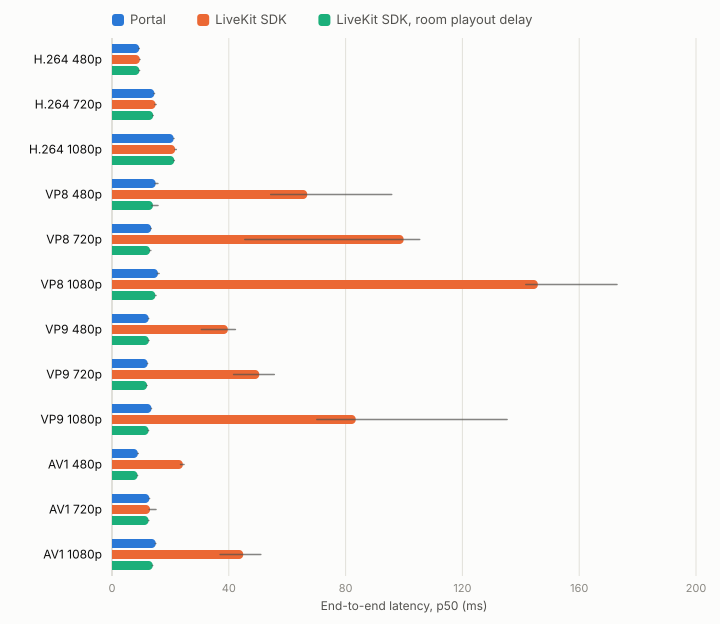
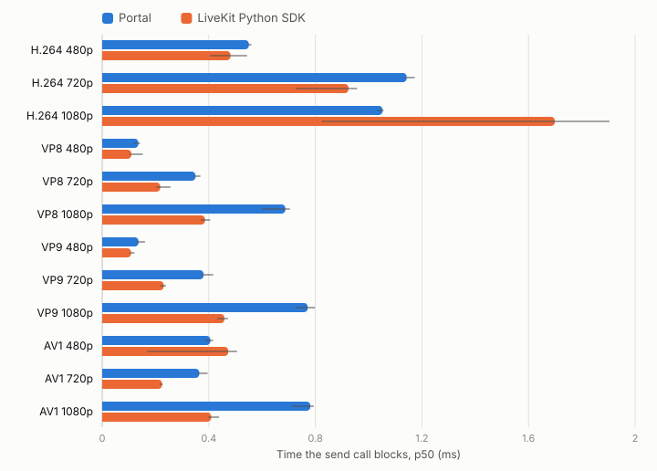

# Benchmarks

How long a frame takes from `send_video_frame` on the robot to the operator's
callback, and how that compares with the plain LiveKit Python SDK doing the same
work. On the WebRTC codecs the two land within each other's run-to-run spread,
except VP8 at 1080p, where Portal is about 10 ms slower.

**Setup.** One Apple M4 Pro running macOS 26.6, a local `livekit-server --dev`
1.13.5, Portal v0.3 built in release mode, and `livekit` 1.1.21 for the SDK. The
robot and the operator run as separate processes. Frames are 30 fps RGB24, a
moving gradient with mild noise, so the encoders do real work. Each run warms up
for 8 s and measures for 10 s.

**Reading the charts.** Each bar is the median of three runs' p50. The thin line
spans the fastest to the slowest run. Latency is the operator's clock minus the
timestamp the robot put on the frame. Both run on one host, so they share a
clock.

The SDK side publishes a camera track sized to the frame, with the same codec,
bitrate ceiling and frame-rate ceiling as Portal, and `user_timestamp` frame
metadata. It receives frames as RGB24, as Portal delivers them. Portal declares
each track with `width` and `height`.

## Video latency

<picture>
  <source media="(prefers-color-scheme: dark)" srcset="benchmarks/e2e-latency-dark.svg">
  
</picture>

- **H.264 is the codec for low latency.** It holds 11 to 22 ms from 480p to
  1080p, and it is the steadiest from run to run.
- **AV1 matches it up to 720p, then climbs** to 53 to 66 ms at 1080p.
- **VP8 is slow on both sides**, 90 to 146 ms at every size. The SDK shows the
  same latency, so it comes from libwebrtc's VP8 encoder, not Portal.
- **VP9 rises with size**, from 24 to 37 ms at 480p to 85 to 98 ms at 1080p, and
  varies the most between runs.

Table

| | Portal | LiveKit Python SDK |
|---|---|---|
| H.264 480p | 11 (10–11) | 11 (9.1–12) |
| H.264 720p | 17 (17–17) | 15 (15–18) |
| H.264 1080p | 22 (22–22) | 22 (20–22) |
| VP8 480p | 101 (61–104) | 90 (86–106) |
| VP8 720p | 112 (63–114) | 90 (56–102) |
| VP8 1080p | 146 (146–150) | 135 (128–145) |
| VP9 480p | 37 (27–41) | 24 (24–36) |
| VP9 720p | 43 (40–47) | 69 (44–76) |
| VP9 1080p | 85 (75–117) | 98 (71–117) |
| AV1 480p | 23 (23–24) | 24 (22–24) |
| AV1 720p | 15 (14–15) | 14 (12–18) |
| AV1 1080p | 66 (54–100) | 53 (40–54) |

## Time the send call blocks

<picture>
  <source media="(prefers-color-scheme: dark)" srcset="benchmarks/send-blocking-dark.svg">
  
</picture>

`send_video_frame` returns in under 1.2 ms on every WebRTC codec and size, so a
30 fps loop spends at most 4% of its frame budget sending. Encoding happens on
libwebrtc's own threads after the call returns.

Portal blocks 0.2 to 0.4 ms longer than the SDK at 1080p on VP8, VP9 and AV1.
That is the copy `send_video_frame` makes of a numpy array (`tobytes()`, 0.29 ms
for a 1080p frame) before handing it to Rust. Passing `bytes` skips it.

Table

| | Portal | LiveKit Python SDK |
|---|---|---|
| H.264 480p | 0.6 (0.5–0.6) | 0.5 (0.4–0.5) |
| H.264 720p | 1.1 (1.1–1.2) | 0.9 (0.7–1.0) |
| H.264 1080p | 1.1 (1.0–1.1) | 1.7 (0.8–1.9) |
| VP8 480p | 0.1 (0.1–0.1) | 0.1 (0.1–0.2) |
| VP8 720p | 0.4 (0.3–0.4) | 0.2 (0.2–0.3) |
| VP8 1080p | 0.7 (0.6–0.7) | 0.4 (0.4–0.4) |
| VP9 480p | 0.1 (0.1–0.2) | 0.1 (0.1–0.1) |
| VP9 720p | 0.4 (0.4–0.4) | 0.2 (0.2–0.2) |
| VP9 1080p | 0.8 (0.7–0.8) | 0.5 (0.4–0.5) |
| AV1 480p | 0.4 (0.4–0.4) | 0.5 (0.2–0.5) |
| AV1 720p | 0.4 (0.4–0.4) | 0.2 (0.2–0.2) |
| AV1 1080p | 0.8 (0.7–0.8) | 0.4 (0.4–0.4) |

## Control

State from the robot and actions from the operator, 100 Hz each, with 14 `f32`
fields per sample. The last two rows add H.264 720p video at 30 fps alongside
state and actions at 90 Hz.

| | Portal | LiveKit Python SDK |
|---|---|---|
| State, robot to operator | 1.9 (1.9–1.9) | 1.9 (1.5–2.2) |
| Action, operator to robot | 1.9 (1.9–1.9) | 1.9 (1.4–2.2) |
| H.264 720p video, with control | 14 (14–14) | 15 (14–15) |
| State, alongside H.264 720p | 1.0 (1.0–1.1) | 1.3 (1.2–1.5) |

All values are p50 in milliseconds: the median of three runs, then the fastest
and slowest run. Video arrived at the full 30 fps in every run on both sides.

## Frame video

The byte-stream codecs have no SDK equivalent, so these are Portal alone, one
run each. MJPEG, PNG and Raw travel as LiveKit byte streams. Those send one chunk
at a time and top out at about 12 MB/s on this setup, so past that rate the link
sets the frame rate, not the encoder. Portal keeps only the newest unsent frame,
so a slow link costs frame rate instead of latency.

| | Send blocks (ms) | End-to-end (ms) | Received fps |
|---|---|---|---|
| MJPEG 480p | 2.5 | 16 | 30 |
| MJPEG 720p | 5.8 | 28 | 30 |
| MJPEG 1080p | 16 | 262 | 28 |
| PNG 480p | 1.4 | 242 | 23 |
| PNG 720p | 4.1 | 336 | 8 |
| PNG 1080p | 9.1 | 511 | 4 |
| Raw 480p | 0.1 | 274 | 13 |
| Raw 720p | 0.5 | 443 | 4 |
| Raw 1080p | 1.0 | 754 | 2 |

MJPEG holds 30 fps through 720p. For PNG and Raw above 480p, use a WebRTC codec,
or lower the resolution or frame rate. See [Frame video](../05-frame-video.md).

## Since v0.2.8

Same harness and machine, p50. v0.2.8 is one run; v0.3 is the median of the
three runs above, and one run for the byte-stream codecs.

| | v0.2.8 send blocks | v0.3 send blocks | v0.2.8 end-to-end | v0.3 end-to-end |
|---|---|---|---|---|
| H.264 720p | 13 ms | 1.1 ms | 49 ms | 17 ms |
| H.264 1080p | 26 ms | 1.1 ms | 49 ms | 22 ms |
| VP9 1080p | 26 ms | 0.8 ms | 132 ms | 85 ms |
| AV1 1080p | 28 ms | 0.8 ms | 106 ms | 66 ms |
| MJPEG 1080p | 64 ms | 16 ms | 150 ms | 262 ms |
| PNG 720p | 38 ms | 4.1 ms | 8318 ms | 336 ms |
| Raw 1080p | 31 ms | 1.0 ms | 12815 ms | 754 ms |

The send call got cheaper from building the library at `opt-level = 3` instead
of `"z"` and from passing frames into Rust without a copy. Frame-video latency
fell because the publisher used to queue up to 60 frames behind a slow link.

MJPEG 1080p is the exception. v0.2.8 spent 64 ms encoding each frame, which held
it to 16 fps, under what the link carries. v0.3 sends 28 fps, which fills the
link, so frames wait in it instead.

## Reproduce

The harness and the raw results behind this page are in
[`scripts/bench`](../../scripts/bench/README.md).
