# Basic example

<picture>
  <source media="(prefers-color-scheme: dark)" srcset="../../../docs/images/example-basic-dark.svg">
  
</picture>

Stream synthetic video and arm state, send actions, and record a session. No
hardware required.

| Script | Role |
|---|---|
| `robot.py` | Streams video and state; executes actions from the active operator. |
| `teleoperator.py` | Takes control, reads observations, and sends actions. |
| `observer.py` | Records a Rerun archive and marks takes with keypoints. |

All three connect to the same room and load `portal.yaml`.

## Requirements

- Python 3.12 and [`uv`](https://docs.astral.sh/uv/)
- A LiveKit server: [LiveKit Cloud](https://cloud.livekit.io) or local
  `livekit-server --dev`.

## Run

From this directory, copy `.env.example`, set your LiveKit URL and credentials,
and install dependencies:

```bash
cp .env.example .env
uv sync
```

Run each role in a separate terminal:

```bash
uv run robot.py           # terminal 1
uv run teleoperator.py    # terminal 2
uv run observer.py        # terminal 3, optional
```

Each role exits after `PORTAL_DURATION_SECONDS`. The observer prints the archive
path. Open it with `rerun <path>` and select `robot_time` to view frames, state,
and actions. Take markers appear under `keypoints/`.

## What you should see

```
[robot] in control: teleoperator
[robot] teleoperator says: hello
[robot] action from teleoperator: {'j1': 0.82, 'j2': 0.57, 'j3': 0.10, 'gripper': True, 'mode': 0}
[robot] e2e_p95=9.1ms
[teleoperator] 320x240 frame, state {'j1': 0.88, 'j2': 0.48, 'j3': 0.11, 'gripper': False, 'mode': 1}
[teleoperator] rtt_p95=3.7ms sync_delta_p95=0.0ms
[observer] recording {'task_description': 'take 0'}
[observer] idle {}
```

If no data arrives, check that the token includes `can_update_own_metadata`.
See [Troubleshooting](../../../docs/10-troubleshooting.md#nothing-is-arriving).

## API usage

- **Robot:** Uses the same `now_us()` timestamp for video and state so Portal
  fuses them into one observation. Reads the active operator's latest action
  with `get_action()` and registers a `say` RPC.
- **Teleoperator:** Claims control with `set_active_operator`, reads typed state
  with `get_observation()`, and calls `send_action`. Passes `in_reply_to_ts_us`
  to enable end-to-end latency measurement.
- **Observer:** Waits for `on_time_synced`, records with `record_to(RrdSink(...))`,
  and marks takes with `send_keypoint`. See
  [Data recording](../../../docs/03-data-recording.md).

`_common.py` handles settings, tokens, synthetic frames, pacing, and
[metrics](../../../docs/09-metrics.md) output.

## Configuration

Set connection details and runtime options in `.env`.

| Variable | Default | Purpose |
|---|---|---|
| `LIVEKIT_URL` | none | Required. Server URL, e.g. `ws://localhost:7880`. |
| `LIVEKIT_API_KEY` | none | Required. |
| `LIVEKIT_API_SECRET` | none | Required. |
| `LIVEKIT_ROOM` | none | Required. Room shared by every role; `.env.example` uses `portal-demo`. |
| `PORTAL_DURATION_SECONDS` | `30` | How long each role runs. |
| `PORTAL_TAKE_SECONDS` | `5` | Length of each take the observer marks. |
| `PORTAL_RECORDING_DIR` | `data/sessions` | Where the observer writes `.rrd` archives. |

Set FPS, tracks, and schemas in `portal.yaml`. See
[Config from YAML](../../../docs/reference/config-file.md).

## Related examples and docs

- [Quickstart](../../../docs/01-quickstart.md)
- [Concepts](../../../docs/02-concepts.md)
- [SO-101 hardware teleoperation](../so101)
- [Latency benchmark](../benchmark)
