# Benchmark example

<picture>
  <source media="(prefers-color-scheme: dark)" srcset="../../../docs/images/example-benchmark-dark.svg">
  
</picture>

Measure latency, jitter, and gaps between arrivals for video, state, observations,
and actions. The robot streams synthetic data; the operator replies to each
observation immediately.

The benchmark uses lossy delivery for state and actions
(`set_state_reliable(False)`, `set_action_reliable(False)`) to avoid waiting for
retransmissions. This favors fresh samples over guaranteed delivery; read latency
percentiles alongside sample counts and arrival gaps.

Both peers use the robot's clock to measure one-way latency across machines.

## Requirements

- Python 3.12 and [`uv`](https://docs.astral.sh/uv/)
- A LiveKit server: local `livekit-server --dev` or
  [LiveKit Cloud](https://cloud.livekit.io). Results include network latency.

## Run

From this directory, copy `.env.example`, set your LiveKit URL and credentials,
and install dependencies:

```bash
cp .env.example .env
uv sync
```

Run the scripts in separate terminals, on one or two machines:

```bash
uv run robot.py           # terminal 1
```

```bash
uv run teleoperator.py    # terminal 2
```

The robot waits for the operator to take control, streams through a warmup, then
measures for `PORTAL_DURATION_SECONDS`. The teleoperator measures until the robot
leaves. Each side prints a live p50/p95 line every second and a results table at
the end.

## Reading the results

Sample output with a local `livekit-server --dev`, 640x480 H264 at 30 fps:

```
[teleoperator] results:
  obs      n=240    p50=   6.15ms p95=   8.30ms p99=  10.01ms max=  10.55ms jitter=    967us max_gap=  36.91ms
  video    n=240    p50=   5.92ms p95=   8.02ms p99=   9.80ms max=  10.27ms jitter=    961us max_gap=  36.92ms
  state    n=241    p50=   1.18ms p95=   1.71ms p99=   2.26ms max=   2.70ms jitter=    180us max_gap=  35.38ms
  portal   rtt_p95=1.50ms clock_uncertainty=315us sync_delta_p95=0us states_dropped=0

[robot] results:
  loop     n=240    p50=   6.84ms p95=   9.23ms p99=  11.14ms max=  35.05ms jitter=   1.25ms max_gap=  61.10ms
  action   n=240    p50=    506us p95=    840us p99=    979us max=  28.79ms jitter=    364us max_gap=  61.10ms
  send     n=240    p50=    187us p95=    324us p99=    536us max=    708us jitter=     46us max_gap=  35.06ms
  portal   e2e_p50=6.64ms e2e_p95=8.93ms
```

Stream definitions:

| Stream   | Measured on | From                         | To                                                |
| -------- | ----------- | ---------------------------- | ------------------------------------------------- |
| `send`   | robot       | `send_video_frame` called    | call returns (RGB to I420 conversion and enqueue) |
| `video`  | operator    | frame captured               | decoded frame delivered to `on_video_frame`       |
| `state`  | operator    | state captured               | state delivered to `on_state`                     |
| `obs`    | operator    | capture                      | fused observation delivered to `on_observation`   |
| `action` | robot       | operator calls `send_action` | action delivered to `on_action`                   |
| `loop`   | robot       | capture                      | corresponding action arrives                      |

Columns:

- **`p50` / `p95` / `p99` / `max`:** Latency percentiles and maximum.
- **`jitter`:** Mean absolute change in latency between consecutive samples.
- **`max_gap`:** Longest interval between arrivals; about 33 ms at a steady 30 fps.

The `portal` line reports SDK [metrics](../../../docs/09-metrics.md):
`e2e_p50/p95` measures the observation-action loop, `rtt_p95` measures round-trip
latency, and `clock_uncertainty` estimates clock error. One-way measurements below
that uncertainty are not reliable.

### Interpreting results

- `obs` waits for both video and state, so it usually tracks the slower video path.
- `loop` is a round trip (RTT): observation latency, action latency, and callback
  processing.
- High `loop` relative to `rtt` can indicate media pipeline overhead. Try smaller
  frames or `PORTAL_CODEC=mjpeg`.
- With `mjpeg`, `png`, or `raw`, video uses reliable data delivery. Large frames
  can compete with state and actions for bandwidth, even when those use lossy
  delivery.
- High `send` latency blocks the robot's control loop. Try a lower resolution.

## Measuring overhead across regions

Network latency can dominate `loop`, especially across regions. To estimate
what LiveKit and Portal add, compare three round-trip measurements between the
same two machines under similar network conditions:

1. **Network floor.** A direct ping between the two machines, outside LiveKit.
   Don't route it through a VPN relay: if both machines are behind NAT, punch a
   direct UDP path rather than measuring the relay.
2. **LiveKit.** The same round trip on the plain LiveKit SDK (`livekit.rtc`):
   the robot sends a data packet and a video frame stamped with
   `FrameMetadata.user_timestamp`, and the other side echoes each one back.
3. **Portal.** The same round trip through Portal: the operator replies with
   `send_action(..., in_reply_to_ts_us=...)` from `on_state`,
   `on_video_frame`, and `on_observation` in separate runs. The included scripts
   reply from `on_observation`; `loop` measures that capture-to-action round trip.

Time every round trip on the robot's clock to avoid clock-sync error. Use the
same delivery mode for data and replies in both SDKs. Interleave the LiveKit and
Portal runs, and keep the ping running throughout to track changes in network
latency.

## Sample results

These three cases range from a single machine to a route across the Pacific.
All use H264 at 640×480 and 30 fps. Latencies in the tables below are **round
trips (RTT)**, timed on the robot's clock. One-way values in the Cloud diagrams
are estimates derived from round trips; the local diagram uses the one-way
measurements shown in the sample output above.

| Case                                                      | Capture-to-action loop, p50 RTT | Portal over plain LiveKit |
| --------------------------------------------------------- | ------------------------------- | ------------------------- |
| [Local server](#local-server)                             | 6.84 ms                         | -                         |
| [Within San Francisco](#within-san-francisco)             | 25.4 ms                         | ≈1–2 ms                   |
| [San Francisco to Hanoi](#san-francisco-to-hanoi-vietnam) | 264.5 ms                        | within ±3 ms              |

### Local server

The robot, operator, and `livekit-server --dev` run on one machine. The loop
is 6.84 ms RTT at p50, with most of that time in the video path. See the diagram
at the top of this page and the sample output in
[Reading the results](#reading-the-results).

### Within San Francisco

<picture>
  <source media="(prefers-color-scheme: dark)" srcset="../../../docs/images/example-benchmark-sf-dark.svg">
  
</picture>

The robot and operator run on separate machines in San Francisco, connected
through [LiveKit Cloud](https://cloud.livekit.io). Traffic passes through the
LiveKit SFU. Each run lasts 30 s; the table reports the median p50 and p95 across
three interleaved runs.

| Round trip (RTT)                  | p50     | p95     | Added                         |
| --------------------------------- | ------- | ------- | ----------------------------- |
| LiveKit SDK, data echo            | 17.6 ms | 23.3 ms | LiveKit route                 |
| Portal, `on_state` → action       | 18.2 ms | 24.9 ms | +0.6 ms Portal                |
| LiveKit SDK, video echo           | 23.9 ms | 54.6 ms | +6.3 ms video pipeline        |
| Portal, `on_video_frame` → action | 26.0 ms | 56.5 ms | +2.1 ms Portal                |
| Portal, `on_observation` → action | 25.4 ms | 57.3 ms | waits for its own video frame |

The LiveKit data round trip is about 18 ms. Portal adds 0.6 ms on the state path
and 2.1 ms on the video path at p50. Video is the slower path, so observations
usually complete when their frames arrive.

### San Francisco to Hanoi, Vietnam

<picture>
  <source media="(prefers-color-scheme: dark)" srcset="../../../docs/images/example-benchmark-cloud-dark.svg">
  
</picture>

The robot runs in San Francisco and the operator in Hanoi, Vietnam, connected
through [LiveKit Cloud](https://cloud.livekit.io). Each run lasts 30 s; the table
reports the median p50 and p95 across three interleaved runs.

| Round trip (RTT)                  | p50      | p95      | Added                         |
| --------------------------------- | -------- | -------- | ----------------------------- |
| LiveKit SDK, data echo            | 259.0 ms | 267.8 ms | LiveKit route                 |
| Portal, `on_state` → action       | 257.3 ms | 270.5 ms | within noise                  |
| LiveKit SDK, video echo           | 264.3 ms | 293.2 ms | +5.3 ms video pipeline        |
| Portal, `on_video_frame` → action | 261.7 ms | 298.3 ms | within noise                  |
| Portal, `on_observation` → action | 264.5 ms | 294.4 ms | waits for its own video frame |

Network latency dominates this route. Portal's p50 round trips stayed within
±3 ms of the corresponding plain LiveKit measurements, below the observed
run-to-run variation.

- **Lossy delivery:** 5–14% of samples or replies did not arrive in each run.
  Lossy delivery avoided retransmission stalls. With reliable delivery, the same
  route stalled for 2–3 s after packet loss, and p95 reached 2.7 s with both
  Portal and the plain SDK.
- **Video gaps:** each run had a video gap of about 3.3 s with both Portal and
  the plain SDK. Missing frames do not contribute latency samples, so these
  gaps appear in `max_gap` rather than p95.

## Configuration

Set options in `.env`. Use the same `PORTAL_FPS` and `PORTAL_CODEC` on both sides.

| Variable                  | Default | Purpose                                                                                                   |
| ------------------------- | ------- | --------------------------------------------------------------------------------------------------------- |
| `LIVEKIT_URL`             | none    | Required. Server URL, e.g. `ws://localhost:7880`.                                                         |
| `LIVEKIT_API_KEY`         | none    | Required.                                                                                                 |
| `LIVEKIT_API_SECRET`      | none    | Required.                                                                                                 |
| `LIVEKIT_ROOM`            | none    | Required. `.env.example` uses `portal-benchmark`.                                                         |
| `PORTAL_FPS`              | `30`    | Capture rate.                                                                                             |
| `PORTAL_CODEC`            | `h264`  | `h264`, `vp8`, `vp9`, `av1`, `mjpeg`, `png` or `raw`. See [Frame video](../../../docs/07-frame-video.md). |
| `PORTAL_FRAME_WIDTH`      | `640`   | Frame width. Must be even.                                                                                |
| `PORTAL_FRAME_HEIGHT`     | `480`   | Frame height. Must be even.                                                                               |
| `PORTAL_WARMUP_SECONDS`   | `3`     | Streamed but not measured, while the encoder ramps up its bitrate.                                        |
| `PORTAL_DURATION_SECONDS` | `30`    | How long the robot measures.                                                                              |

The token requests a 0–1 ms playout delay to reduce receiver buffering.

## Files

| File              | What it does                                                       |
| ----------------- | ------------------------------------------------------------------ |
| `robot.py`        | Streams video and state, measures `loop`, `action` and `send`.     |
| `teleoperator.py` | Replies to every observation, measures `obs`, `video` and `state`. |
| `_common.py`      | Settings, tokens, test frames, pacing, and statistics.             |
