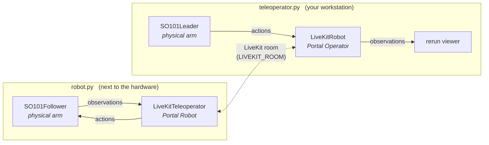

# SO-101 teleoperation

<picture>
  <source media="(prefers-color-scheme: dark)" srcset="../../../docs/images/example-so101-dark.svg">
  
</picture>

Control an SO-101 follower arm with a remote SO-101 leader over Portal. View
camera video, joint positions, and actions in [Rerun](https://rerun.io).

Run one script on each machine:

| Script            | Runs on                          | Hardware attached                 |
| ----------------- | -------------------------------- | --------------------------------- |
| `robot.py`        | The machine next to the arm      | SO-101 follower + USB camera      |
| `teleoperator.py` | The operator's laptop            | SO-101 leader arm                 |

Both scripts must connect to the same LiveKit room.

## 1. Prerequisites

- Python 3.12+ and [`uv`](https://docs.astral.sh/uv/)
- A LiveKit server. Either [LiveKit Cloud](https://cloud.livekit.io) or a
  local one (`livekit-server --dev`)
- SO-101 leader + follower arms (Feetech STS3215 motors), each with their
  own USB-serial controller
- One OpenCV-compatible camera on the robot side
- The Portal native library built once at the repo root:
  `bash scripts/build_ffi_python.sh`

## 2. Install

From this directory:

```bash
uv sync
```

`uv sync` installs LeRobot, Rerun, and the Portal SDK and plugins. Portal packages
use editable installs from `../../../python/packages/`.

## 3. Find the serial ports

Run the port finder for each arm and follow its prompts:

```bash
# Run once for the follower, once for the leader.
uv run lerobot-find-port
```

Save both paths for `.env`, e.g. `/dev/tty.usbmodem...` on macOS or
`/dev/ttyACM...` on Linux.

## 4. Calibrate the arms

Calibrate before first use and after replacing servos or reassembling an arm.
Calibration files are stored in `~/.cache/huggingface/lerobot/calibration/`, keyed
by the device ID. Use the same IDs in `.env`.

### 4a. Leader

```bash
uv run lerobot-calibrate \
  --teleop.type=so101_leader \
  --teleop.port=/dev/tty.usbmodem-LEADER \
  --teleop.id=so101_leader
```

Follow the on-screen prompts:

1. Move the arm to the **middle of its range**, press enter → sets homing offsets.
2. Move **every joint through its full range** (except `wrist_roll`, which
   is treated as full-turn), press enter → records min/max.

### 4b. Follower

```bash
uv run lerobot-calibrate \
  --robot.type=so101_follower \
  --robot.port=/dev/tty.usbmodem-FOLLOWER \
  --robot.id=so101_follower
```

> Leaders are torque-off during calibration (you move them by hand).
> Followers will self-drive during range capture. Keep clear of the arm.

## 5. Configure `.env`

```bash
cp .env.example .env
```

Set the LiveKit connection, serial ports, and camera options:

```ini
LIVEKIT_URL=wss://your-project.livekit.cloud      # or ws://localhost:7880
LIVEKIT_API_KEY=...
LIVEKIT_API_SECRET=...

LIVEKIT_ROOM=so101-portal                         # any string, both sides must match
PORTAL_FPS=30

# Robot side
SO101_FOLLOWER_PORT=/dev/tty.usbmodem-FOLLOWER
SO101_FOLLOWER_ID=so101_follower                  # must match --robot.id from step 4b
SO101_CAMERA_NAME=front
SO101_CAMERA_INDEX=0
SO101_CAMERA_WIDTH=640
SO101_CAMERA_HEIGHT=480

# Operator side
SO101_LEADER_PORT=/dev/tty.usbmodem-LEADER
SO101_LEADER_ID=so101_leader                      # must match --teleop.id from step 4a
```

Use the same LiveKit settings on both machines. Set machine-specific values in
separate `.env` files or in `.env.local`, which overrides `.env`.

## 6. Run

**Terminal 1, on the machine wired to the follower:**

```bash
uv run robot.py
```

**Terminal 2, on the operator's laptop:**

```bash
uv run teleoperator.py
```

Rerun opens on the operator machine. Select the `robot_time` timeline to view:

- `observation/<camera_name>`: follower camera video.
- `observation/<motor>.pos`: follower joint positions as scalar plots.
- `action/<motor>.pos`: commanded positions from the leader.

Stop either side with Ctrl-C.

## 7. Troubleshooting

**"No calibration file found"**. Run `lerobot-calibrate` for the affected arm.
Check that its ID in `.env` matches the calibration ID.

**Follower doesn't move**. Check that both scripts use the same LiveKit room
and inspect their output for connection errors. Tokens need `can_publish` and
`can_subscribe`; the token helper sets both.

**Laggy or frozen video**. Confirm `PORTAL_FPS` matches on both sides. If
you're on a local dev server, keep the two scripts on the same LAN for
lower network latency.

**Camera not detected**. Try another `SO101_CAMERA_INDEX` (0, 1, 2…). On
macOS, grant camera permission if prompted, then rerun.

**`ImportError: cannot find liblivekit_portal_ffi`**. Build the native
library: `cd ../../.. && bash scripts/build_ffi_python.sh`.

## Architecture



The Portal plugins implement LeRobot's `Robot` and `Teleoperator` interfaces
for remote observation and action exchange.
